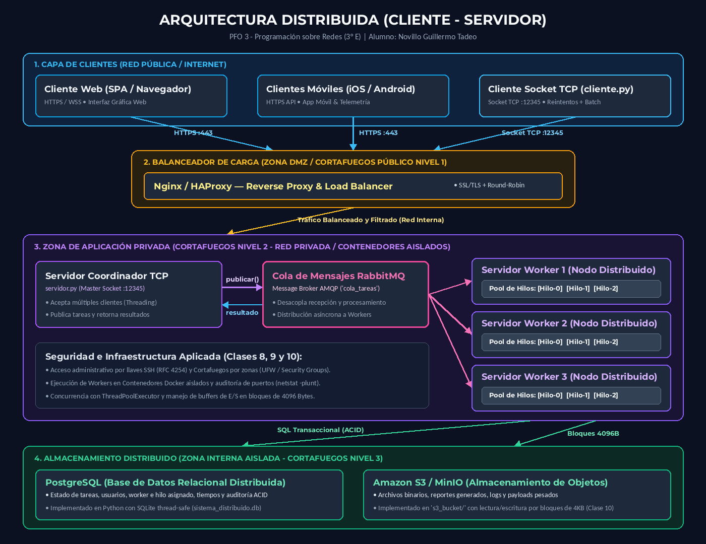
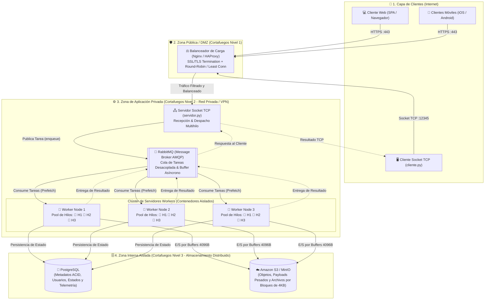

# Programación sobre Redes

- **Materia:** Programación sobre Redes
- **Curso:** 3° E
- **Alumno:** Novillo Guillermo Tadeo
- **Trabajo Práctico:** PFO 3: Rediseño como Sistema Distribuido (Cliente-Servidor)
- **Repositorio:** [https://github.com/guinovi/pr_pfo_03](https://github.com/guinovi/pr_pfo_03)

---

## 📌 PFO 3: Rediseño como Sistema Distribuido (Cliente-Servidor)

Evolución del sistema monolítico de tareas (PFO 2) hacia una **arquitectura distribuida de alta disponibilidad y procesamiento concurrente**, implementada en Python con sockets TCP nativos, desacoplada mediante un message broker (RabbitMQ simulado), un clúster de servidores workers con pools de hilos dedicados y almacenamiento distribuido híbrido (PostgreSQL + S3).

---

## 📑 Tabla de Contenidos
1. [Diagrama de Arquitectura del Sistema](#-1-diagrama-de-arquitectura-del-sistema)
2. [Descripción de Componentes del Sistema Distribuido](#-2-descripción-de-componentes-del-sistema-distribuido)
   - [2.1 Clientes (Web, Móviles, Consola TCP)](#21-clientes-móviles-web-y-tcp)
   - [2.2 Balanceador de Carga (Nginx / HAProxy)](#22-balanceador-de-carga-nginx--haproxy)
   - [2.3 Cola de Mensajes (RabbitMQ)](#23-cola-de-mensajes-rabbitmq)
   - [2.4 Servidores Workers y Pools de Hilos](#24-servidores-workers-y-pools-de-hilos)
   - [2.5 Almacenamiento Distribuido (PostgreSQL + S3)](#25-almacenamiento-distribuido-postgresql-y-amazon-s3)
3. [Fundamentos de Seguridad y Redes (Clases 8, 9 y 10)](#-3-fundamentos-de-seguridad-y-redes-clases-8-9-y-10)
4. [Estructura del Proyecto](#-4-estructura-del-proyecto)
5. [Instrucciones de Instalación y Ejecución](#-5-instrucciones-de-instalación-y-ejecución)
6. [Evidencia de Pruebas Automatizadas](#-6-evidencia-de-pruebas-automatizadas)

---

## 📐 1. Diagrama de Arquitectura del Sistema

El diagrama ilustra la separación de responsabilidades y la segmentación en zonas de red de acuerdo a las directivas de seguridad de la infraestructura:



> 💡 *El repositorio también incluye la versión vectorial escalable en [diagramas/arquitectura_distribuida.svg](diagramas/arquitectura_distribuida.svg).*

### Diagrama Interactivo en Mermaid



---

## 🏛️ 2. Descripción de Componentes del Sistema Distribuido

### 2.1 Clientes (Móviles, Web y TCP)
- **Cliente Web (SPA):** Interfaz para usuarios finales que se comunica vía HTTP/REST o WebSockets a través del balanceador.
- **Clientes Móviles (iOS/Android):** Dispositivos que envían telemetría o solicitudes asíncronas optimizando consumo de batería y ancho de banda.
- **Cliente Socket TCP ([`cliente.py`](cliente.py)):** Cliente de consola desarrollado en Python estándar. Implementa **reintentos automáticos con retroceso (backoff)** para tolerar caídas momentáneas de red (patrón visto en la **Clase 10**), además de permitir el despacho interactivo y en ráfagas concurrentes para pruebas de estrés.

### 2.2 Balanceador de Carga (Nginx / HAProxy)
- Ubicado en la **DMZ (Demilitarized Zone)** o red perimetral.
- Es el único punto de entrada público expuesto a Internet en los puertos 80, 443 (HTTP/HTTPS) y 12345 (TCP Stream proxy).
- **Funciones críticas:**
  1. **Terminación SSL/TLS:** Descarga de criptografía para que los servidores internos se comuniquen en texto claro sobre la red privada interna.
  2. **Algoritmos de Distribución:** Round-Robin, Least Connections o IP-Hash para balancear sesiones de sockets.
  3. **Mitigación DoS y Rate Limiting:** Protege a los workers internos de saturación de conexiones TCP no autorizadas.

### 2.3 Cola de Mensajes (RabbitMQ)
- Actúa como **Message Broker (AMQP)** intermedio entre el servidor receptor de sockets y los servidores workers.
- **Ventajas de desacoplamiento:**
  - Si llega un aluvión de miles de tareas simultáneas, el servidor de sockets no colapsa ni rechaza conexiones: encola las solicitudes en RabbitMQ y responde inmediatamente o mantiene la promesa de entrega.
  - Si un worker se cae o se reinicia, la tarea permanece en la cola (persistencia de mensajes y reconocimientos `ACK`) y es tomada por otro worker sin pérdida de datos.

### 2.4 Servidores Workers y Pools de Hilos
- Múltiples nodos de procesamiento distribuidos (`Worker-1`, `Worker-2`, `Worker-3`), concebidos para ejecutarse en entornos o contenedores aislados (**Clase 9**).
- **Pool de Hilos (`ThreadPoolExecutor`):** Cada worker posee su propio conjunto preasignado de hilos de ejecución concurrentes. Esto evita el sobrecosto de crear y destruir hilos por cada tarea y permite procesar múltiples solicitudes de Entrada/Salida en paralelo.
- **Nota sobre el GIL (Global Interpreter Lock - Clase 10):** En Python, para tareas intensivas en CPU que requieran exprimir todos los núcleos del procesador, se sustituye el pool de hilos por un pool de procesos (`multiprocessing.Pool`), superando la limitación del GIL. Para tareas con predominancia de red, base de datos y E/S de archivos, el pool de hilos (`threading`) ofrece máxima eficiencia con mínimo consumo de memoria.

### 2.5 Almacenamiento Distribuido (PostgreSQL y Amazon S3)
Arquitectura de persistencia desacoplada en dos niveles:
1. **PostgreSQL (Base de Datos Relacional):**
   - Almacena datos estructurados con garantías **ACID** (Atomicidad, Consistencia, Aislamiento y Durabilidad): usuarios, credenciales, identificadores de tarea, estado (`PENDIENTE`, `EN_PROCESO`, `COMPLETADA`), worker e hilo asignados, y marcas de tiempo de auditoría.
   - *Simulación en el código:* Implementado mediante `sqlite3` nativo con bloqueo thread-safe (`sistema_distribuido.db`).
2. **Amazon S3 / MinIO (Object Storage):**
   - Diseñado para almacenar datos no estructurados de gran tamaño (cargas útiles pesadas, imágenes, logs completos de ejecución y reportes generados).
   - *Simulación en el código:* Directorio `s3_bucket/` local donde los archivos se leen y escriben en **bloques de buffer de 4096 / 8192 Bytes**, aplicando directamente las mejores prácticas de la **Clase 10** para optimizar el uso de memoria RAM.

---

## 🛡️ 3. Fundamentos de Seguridad y Redes (Clases 8, 9 y 10)

El diseño del sistema incorpora los conceptos analizados en el aula virtual:

| Concepto de Cátedra | Aplicación en este Proyecto | Referencia Técnica |
|---|---|---|
| **Cortafuegos en 3 Niveles (Clase 8)** | • **Público (DMZ):** Expone solo Nginx/HAProxy (80, 443, 12345).<br/>• **Privado:** Servidor de Sockets, RabbitMQ y Workers accesibles solo internamente.<br/>• **Interno:** PostgreSQL y S3 bloqueados del exterior. | UFW / iptables (Clase 8) |
| **Modelo de Responsabilidad Compartida** | En la nube (AWS), el proveedor protege la infraestructura global (hardware, red subyacente), mientras que el usuario es responsable de configurar firewalls (Security Groups), parches en los workers, gestión de accesos y cifrado de datos. | [AWS Well-Architected Security](https://docs.aws.amazon.com/es_es/wellarchitected/latest/security-pillar/shared-responsibility.html) |
| **Acceso Seguro por SSH** | Administración remota cifrada de los servidores workers mediante autenticación con par de llaves criptográficas (pública/privada), eliminando contraseñas débiles y mitigando ataques de fuerza bruta. | [RFC 4254 - SSH Connection](https://www.rfc-editor.org/rfc/rfc4254.html) |
| **Auditoría de Servicios (Clase 9)** | Verificación de puertos en escucha y servicios activos (`sudo netstat -plunt`) para asegurar que solo el socket del balanceador escuche en `0.0.0.0` y los servicios internos queden enlazados a `127.0.0.1` o interfaces privadas. | Netstat / IDS AIDE (Clase 9) |
| **Aislamiento en Contenedores (Clase 9)** | Despliegue de cada Worker en contenedores Docker independientes para limitar el radio de explosión (blast radius) ante posibles vulnerabilidades. | Docker / cgroups (Clase 9) |
| **Sockets TCP y Buffers de E/S (Clase 10)** | Transferencia de archivos y datos en bloques de 4096 bytes (`open(..., buffering=4096)`) para evitar el consumo desmedido de memoria con grandes volúmenes de datos. | Clase 10 / [RFC 1151](https://datatracker.ietf.org/doc/html/rfc1151) |
| **Reintentos de Conexión (Clase 10)** | Manejo robusto de excepciones de sockets (`socket.error`, `ConnectionRefusedError`) en el cliente con bucle de reintentos escalonados. | Clase 10 (conectar_con_reintentos) |

---

## 📂 4. Estructura del Proyecto

```text
tp3/
├── servidor.py               # Servidor TCP multihilo + RabbitMQ simulado + Clúster Workers + BD/S3
├── cliente.py                # Cliente TCP interactivo y modo --demo con reintentos automáticos
├── test_servidor.py          # Suite de pruebas unitarias automatizadas (unittest)
├── iniciar.py                # Lanzador unificado (Servidor + Cliente automatizados)
├── iniciar.sh                # Script de inicio rápido para Linux / macOS
├── diagramas/
│   ├── arquitectura_distribuida.png   # Diagrama de arquitectura renderizado en alta definición
│   └── arquitectura_distribuida.svg   # Diagrama vectorial escalable
├── .gitignore                # Reglas de exclusión para Git (bases de datos, buckets y temporales)
└── README.md                 # Documentación técnica completa y justificación arquitectónica
```

---

## 🚀 5. Instrucciones de Instalación y Ejecución

El proyecto fue desarrollado utilizando **100% la biblioteca estándar de Python** (`socket`, `threading`, `concurrent.futures`, `queue`, `json`, `sqlite3`, `hashlib`), por lo que **no requiere instalar dependencias externas ni entornos complejos** para su ejecución.

### Opción Rápida: Lanzador Unificado (Servidor + Cliente) ⭐

En Linux / macOS:
```bash
./iniciar.sh
# O alternativamente:
python3 iniciar.py
```

Para correr la demostración integral automatizada:
```bash
python3 iniciar.py --demo
```

---

### Opción Manual (En terminales separadas):

#### Terminal 1 — Servidor Distribuido:
```bash
python3 servidor.py
```
*El servidor iniciará el socket TCP en `127.0.0.1:12345`, inicializará la cola RabbitMQ simulada, creará los 3 Workers con sus pools de hilos y dejará listo el almacenamiento distribuido.*

#### Terminal 2 — Cliente Interactivo:
```bash
python3 cliente.py
```
*Se presentará el menú interactivo con las opciones de envío individual, ráfagas concurrentes, consulta de métricas del clúster y lectura del historial de PostgreSQL.*

---

## 🧪 6. Evidencia de Pruebas Automatizadas

El proyecto incluye pruebas unitarias completas bajo el framework estándar `unittest`:

```bash
python3 test_servidor.py
```

### Salida de Ejecución:
```text
=================================================================
 SERVIDOR DISTRIBUIDO DE TAREAS (PFO 3 - REDES)
 Escuchando en TCP 127.0.0.1:12456
 Componentes integrados:
  - Cola de Mensajes: RabbitMQ simulada
  - Clúster Workers: 3 nodos con Pool de Hilos
  - Almacenamiento: PostgreSQL (SQLite) + S3 ('s3_bucket/')
 Presione Ctrl+C para detener el servidor.
=================================================================
[CONEXIÓN] Cliente conectado desde ('127.0.0.1', 57898)
.[DESCONEXIÓN] Cliente ('127.0.0.1', 57898) desconectado.
[CONEXIÓN] Cliente conectado desde ('127.0.0.1', 57908)
.[DESCONEXIÓN] Cliente ('127.0.0.1', 57908) desconectado.
[CONEXIÓN] Cliente conectado desde ('127.0.0.1', 57918)
[DESCONEXIÓN] Cliente ('127.0.0.1', 57918) desconectado.
.[CONEXIÓN] Cliente conectado desde ('127.0.0.1', 57920)
.[DESCONEXIÓN] Cliente ('127.0.0.1', 57920) desconectado.
[CONEXIÓN] Cliente conectado desde ('127.0.0.1', 57924)
[DESCONEXIÓN] Cliente ('127.0.0.1', 57924) desconectado.
[CONEXIÓN] Cliente conectado desde ('127.0.0.1', 57938)
.[SERVIDOR DETENIDO]
[DESCONEXIÓN] Cliente ('127.0.0.1', 57938) desconectado.

----------------------------------------------------------------------
Ran 5 tests in 0.893s

OK
```

### Casos Evaluados:
1. **`test_01_ping_conexion`**: Handshake y conectividad básica TCP cliente-servidor.
2. **`test_02_tarea_hash_criptografico`**: Recepción, encolado y procesamiento en worker asignado, validando hash SHA-256.
3. **`test_03_almacenamiento_s3_por_bloques`**: Escritura y lectura en almacenamiento de objetos en bloques de 4KB con buffers nativos (Clase 10).
4. **`test_04_batch_concurrente_pool_hilos`**: Verificación de despacho concurrente entre múltiples workers y múltiples hilos del pool.
5. **`test_05_estado_cluster_e_historial`**: Métricas de cola RabbitMQ y persistencia de auditoría en base de datos relacional.

